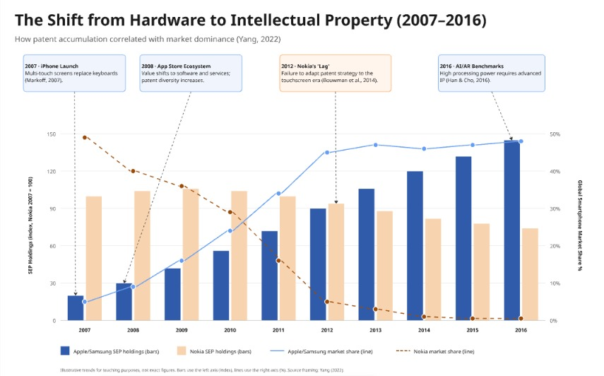

The timeline of mobile phones and smartphones

Introduction: 
This project will talk about all of the technological advancements, from the first mobile phone to the modern smartphones we use today. It will begin with the first call made from a mobile phone on April 3rd, 1973 in New York City. It was made by an engineer named Marty Cooper from the telecommunications firm Motorla and it was made to the company's competitor, Bell Laboratories.
Before this, there were no mobile phones. Calls could only be made on telephones in a room where the telephone was plugged into the wall. Needless to say, this made phone calls a lot easier to use.

Texting did not become available until the 1990s, when the second generation of phones used a newly invented 2G (second generation) signal. Around 1997, the first mobile games were made (such as the very popular game Snake) and cameras were added in 1999 for the first time.
Many experts and mobile phone historians have different views on what was the first smartphone. The reason for this is that the elements that make up a smartphone (i.e. apps and sending emails) existed on various models of phones at different times. However, the device often seen as the first smartphone is the IBM Simon from 1994, as it had a touchscreen and calendar functions and could send faxes and emails. Another model seen as having smartphone capabilities is the Blackberry, launched in 1999, which had a keyboard instead of traditional telephone buttons and could send and receive emails.

Conclusion: 
The smartphone that we are all familiar with today, first appeared in January of 2007. Steve Jobs, from the Apple company, announced the iPhone to a crowd in San Francisco, which combined the music player, iPod, internet capabilities and touch screen. It was soon followed by the iPhone 3G, where users could go onto an online store and download any apps of their choice.

# 2. Historical Development: From Nokia to iPhone

## Origins and Early Evolution (1980s–2006)
The transition from feature phones to smartphones was not instantaneous; it was preceded by decades of innovation that established mobile computing's foundational utility.

-   **1987–1990s: Establishing Digital Standards:** Nokia’s Mobira Cityman (1987) and subsequent GSM devices pioneered digital 2G networks, enabling reliable SMS and voice clarity. This era defined mobile phones as durable, single-purpose communication tools rather than computing platforms (Nokia 1996).
-   **1996: The First Smartphone Prototype:** The Nokia 9000 Communicator introduced a clamshell design with a QWERTY keyboard and horizontal screen for email and web browsing. Despite being technologically ahead of its time, it remained a niche business tool due to high costs and limited software ecosystems (Mobile Phone Museum 2024).
-   **2003–2006: Hardware Proliferation vs. Software Stagnation:** While hardware evolved rapidly with devices like the Nokia N95 offering GPS and 5MP cameras operating systems like Symbian remained fragmented and stylus dependent. BlackBerry dominated enterprise mobility through push email, but consumer devices lacked a unified app ecosystem, creating a "software gap" that Apple would later exploit (Nield 2026).

These early innovations proved market demand for mobile data existed, but they lacked the seamless hardware-software integration that would define the post 2007 smartphone era.

## Technological Evolution (2007–2016)
The speed of technological change during this period was rapid. The table below, based on data from Han and Cho (2016), illustrates the dramatic increase in smartphone performance benchmarks that competitors achieved while Nokia lagged behind:

| Year | Key Technological Shift | Industry Impact | Source |
| :--- | :--- | :--- | :--- |
| 2007 | Multi-touch Capacitive Screens | Replaced physical keyboards; enabled gesture-based UI | Markoff (2007) |
| 2008 | App Store Ecosystems | Shifted value from hardware sales to recurring software revenue | Han & Cho (2016) |
| 2010 | Retina Display & High-Res Media | Enabled mobile video consumption and digital photography dominance | Han & Cho (2016) |
| 2012 | 4G LTE Integration | Unlocked streaming, cloud gaming, and real-time AR capabilities | Yang (2022) |
| 2014 | Wearable Integration (Apple Watch) | Extended ecosystem to health tracking and notifications | Goggin (2013) |
| 2016 | Advanced AI/AR Benchmarks | Standardized on-device processing for facial recognition | Han & Cho (2016) |

## Competitive Landscape & Patent Analysis
While hardware evolved, competitive advantage increasingly shifted toward intellectual property. Yang (2022) has described that patent based strategies became a primary differentiator, explaining why firms like Nokia struggled to maintain market dominance despite their historical engineering strength. In the illustration below, I tried to visualise some data showing patent accumulation and market share that determined the "curse of agility".

Figure 1: Correlation between SEP holdings and market dominance, illustrating Nokia's strategic lag (Yang, 2022; Bouwman et al., 2014).

## Cultural Adaptation of Mobile Technology
Beyond specifications and patents, the era was defined by how users integrated devices into daily life. Goggin (2013) argues that the iPhone's success was not merely technical but cultural, reshaping consumption patterns and social interactions through mobile adaptation. This shift transformed the phone from a communication tool into a central hub for media, identity, and social connection.

## Modern Era and Present Day (2017–2026)
The evolution did not stop in 2016. The last decade has been defined by innovations and contextual intelligence:

-   **2019:** Commercial foldable displays challenged the rigid slab design, enabling tablet-sized productivity screens in pocketable formats.
-   **2020:** Global 5G rollout reduced latency to <10ms, unlocking real-time cloud gaming and edge computing capabilities.
-   **2023–2026:** On-device Generative AI transformed smartphones from app launchers into proactive intelligent agents. Neural Processing Units (NPUs) now run LLMs locally, prioritizing privacy over cloud dependency.
-   **2024–2026:** Regulatory frameworks like the EU Digital Markets Act forced interoperability, breaking down walled gardens and reshaping business models.

This current era represents a fundamental pivot: computing is no longer about accessing information, but about anticipating user needs through contextual AI.

References: https://www.bbc.co.uk/bitesize/articles/z62gjfr"
