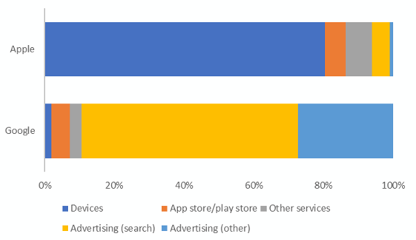
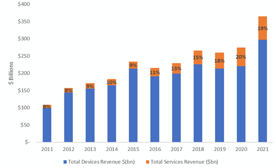

The Business Viewpoint of the Evolution from Phones to Smart Phones such as the Switch from Nokia to the iPhone.

The business perspective of the evolution of phones to smartphones is how this change effected how business operate, the revenue generated and market positions. 

The Business viewpoint of the switch from mobile phones to smart phones such as what infrastructure and hardware was made and how that effected the current market of smart phones. When mobile phones started to emerge onto the market there were two main competitors for mobile phone devices, Nokia and Motorola. This has now changed as there are several larger companies within the smartphone space, Apple, Samsung, Google and Xiaomi. There are two different types of companies here, one which makes hardware and one which makes software with a revenue cut, Apple, Samsung and Xiaomi sell hardware primarily but google makes the operating system and main app store for both Samsung and Xiaomi and most Android devices.

How did this Technological Change effect Businesses?

Mobile infrastructure has Improved dramatically allowing for a more than 100x speed increase allowing for the use of video streaming to happen. When the first 2g mobile network (1990-2006) was made it allowed for a network speed of 14.4kbps, this allowed for voice calls and SMS. 3g (2006-2011) allowed for high-speed browsing to be done on a phone at 3.1Mbps, this was a huge improvement, people could easily browse the web, and shop online from a mobile device. 4G (2009-2020) had a max speed of 100Mbps, this was an even bigger jump and allowed for streaming of Video. (Bahia et al., 2019, p. 4)

According to (Bahia et al., 2019, p. 16), mobile infrastructure improves the search for goods, services and labour, to give an example it is easier than ever for a user-to-user mobile data to search on the internet for a given services, then pay for that services using online, mobile banking.

Also, in this paper it estimates that for each penetration result of 10% on average increase of GDP per capita between 0.59% and 0.76%

Market penetration rate= Customers ÷ target market size × 100, 75,000 ÷ 500,000 × 100 = 15%

There were three major types of companies that are relevant to the evolution from phones to smart phones. network services, terminals, and network infrastructure. (Garcia-Swartz and Campbell-Kelly, 2022)

 

‌ Network infrastructure is hardware that carries the signals, such as the radio towers. This was geographically local competition as companies were competing for the best hardware network within a given region. AT&T and Motorola competing in The United States of America. Nokia In Finland and Ericsson In Sweden. There are other smaller companies within other countries, but these companies were the larges and some of them also made terminals (the mobile phones). (Garcia-Swartz and Campbell-Kelly, 2022)

Network Services are the standards that are used over the hardware of the network infrastructure, this provides a service of communication. This was once again a geographically local competition as companies would compete to how had a better service on the network provided by the network infrastructure companies. In the US there were several companies that had control over local areas such as cities. The United States of Americas Government made a report (General Accounting Office, 1992, p.36)  and in this report, it stated that the cellular network service industry has only 92,999 subscribers in 1984 to about 7.6 million subscribers in 1991. 

Terminals are the physical device that is used, such as a phone, this word does also apply to desktop computers and other devices that have a terminal. Ther were a few major companies that made terminals in the beginnings of mobile phones most notably Nokia as it had the most phone sales and the largest market share

**Financial Impact of the First Phones**

The first cellular network was first made in the Chicago network, for only a few thousand participants as it was a trial run. After a few years other countries started to make their own cellular networks in total only around 2.5 million in the 1980’s. Other countries started to make their own cellular networks and devices for these networks. One of these devices is the Nokia’s Mobira Cityman (1987) for the Global Systems for Mobile communications on the 2GigaHrtz network.

In the United States of America the FCC reported that there were 92,000 subscribers in 1984 then 7.6 million subscribers in 1991. The revenue increased dramatically from $482 million in 1986 to over $6.7 billion in 1991. (General Accounting Office, 1992)

1990-2000 was shortly after Nokia and Motarola had made their mobile phones and were competing for market dominance around 350 million units sold in the years between 1990 and 2000. (Wikipedia, 2021) and (Edmonds, 2013)

| **Manufacturer** | **Model** | **Smartphone?** | **Year** | **Unites Sold****(Millions)** |
| :---: | :---: | :---: | :---: | :---: |
| Nokia | 2110 (2110i/2120/2140/2190) | No | 1994 | 20 |
| Motorola | StarTAC[ | No | 1996 | 60 |
| Nokia | 3210[ | No | 1999 | 160 |
| Nokia | 3310 (3330) | No | 2000 | 126 |
Markets within Phones, Operating system, Browers, and App Markets

When smartphones were first made, each manufacturer has their own operating system with limited functionality, this changed when apple made the first iPhone, apple made an Appstore that allowed users to download software to their phone for a selection of verified applications. This ecosystem enabled apple to take a %30 cut of revenue that app developers made. Later on, Google bought, and let other phone manufacturers use it, they also had an app marketplace that was pre-installed called “The Play store”, Google took a %30 revenue cut from developers from this platform. Given that android was used by more phone manufacturers they got a higher amount of revenue than apple per device. (Mobile ecosystems, 2022, p.27)

This figure shows the global revenue sources for 2021, you can clearly see that both Google does gain of revenue from the search engine that they have pre-installed on most android devices. (Mobile ecosystems, 2022, p.20)

This is Apples revenue per year from 2011 to 2021 in Billion$ per year from 2011 till 2021. (Mobile ecosystems, 2022, p.25)

This shows the increase in value of the company and that slow goring revenue of the services revenue which is primarily %30 cut from AppStore developer revenue.

In summary the use of mobile technology has created several markets other than the sale of mobile hardware itself, it has also had a great impact on the global market as these devices became pieces of hardware that most people have access to. The use of mobile phones allowed for the better interconnectivity which included users finding out information faster such as services that they can hire and then pay for. 

Bahia, K., Castells, P., & Pedrós, X. (2019). The impact of mobile technology on economic growth: global insights from 2000-2017 developments. ECONSTOR. [https://www.econstor.eu/bitstream/10419/205164/1/Bahia-et-al.pdf](https://www.econstor.eu/bitstream/10419/205164/1/Bahia-et-al.pdf)

Garcia-Swartz, D.D. and Campbell-Kelly, M. (2022). Cellular. ISBN electronic. [online] doi:10.7551/mitpress/11542.001.0001.

General Accounting Office (1992). Concerns about competition in the Cellular Telephone Service Industry. [online] Available at: https://www.gao.gov/assets/rced-92-220.pdf [Accessed 27 Nov. 2026].

Wikipedia. (2021). List of best-selling mobile phones. [online] Available at: https://en.wikipedia.org/wiki/List_of_best-selling_mobile_phones [Accessed 27 Nov. 2026].

Edmonds, R. (2013). 40 Years have passed for mobile phones and Nokia dominates bestsellers list. [online] Windows Central. Available at: https://www.windowscentral.com/40-years-mobile-phones-have-passed-nokia-dominates-bestsellers-list [Accessed 27 Nov. 2026].

Mobile ecosystems. (2022). [online] Available at: https://assets.publishing.service.gov.uk/media/63f61bc0d3bf7f62e8c34a02/Mobile_Ecosystems_Final_Report_amended_2.pdf [Accessed 27 Nov. 2026].

