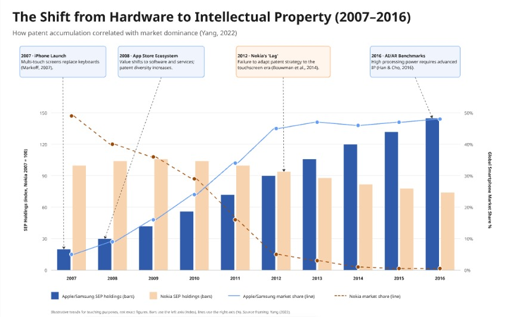

# 2. Historical Development

## Origins and Early Evolution (1990s–2006)

Before the smartphone revolution, mobile computing was defined by business utility and physical keyboards. Key milestones established the foundation for modern devices:

-   **1994:** IBM Simon Personal Communicator launched as the first device combining a touchscreen, email, and cellular capabilities, establishing the "smartphone" concept decades ahead of its time.
-   **2002:** BlackBerry 5810 introduced push email and QWERTY keyboards, dominating the enterprise market and proving mobile data had commercial value.
-   **2004:** Symbian OS became the world's most popular smartphone platform, but its fragmented ecosystem and poor developer tools created a "walled garden" that stifled innovation.

These early innovations proved demand existed, but lacked the unified hardware-software integration that would later define the post-2007 era.

# Technological Evolution (2007–2016)

The speed of technological change during this period was rapid. The table below, based on data from Han and Cho (2016), illustrates the dramatic increase in smartphone performance benchmarks that competitors achieved while Nokia lagged behind:

| Year | Key Technological Shift | Industry Impact |
| :--- | :--- | :--- |
| 2007 | Multi-touch Capacitive Screens | Replaced physical keyboards; enabled modern UI |
| 2008 | App Store Ecosystems | Shifted value from hardware to software/services |
| 2012 | 4G LTE Integration | Enabled high-speed mobile data and streaming |
| 2016 | Advanced Performance Benchmarks | Standardized high-processing power for AI/AR |

## Competitive Landscape & Patent Analysis

While hardware evolved, competitive advantage increasingly shifted toward intellectual property. Yang (2022) highlights that patent-based strategies became a primary differentiator, explaining why firms like Nokia struggled to maintain market dominance despite their historical engineering strength. As illustrated below, the divergence between patent accumulation and market share reveals the "curse of agility" that plagued incumbent firms.

*Figure 1: Correlation between SEP holdings and market dominance, illustrating Nokia's strategic lag (Yang, 2022; Bouwman et al., 2014).*

## Cultural Adaptation of Mobile Technology

Beyond specifications and patents, the era was defined by how users integrated devices into daily life. Goggin (2013) argues that the iPhone's success was not merely technical but cultural, reshaping consumption patterns and social interactions through mobile adaptation. This shift transformed the phone from a communication tool into a central hub for media, identity, and social connection.

## References for this Section

- Agar, J. (2013). *Constant touch: A global history of the mobile phone*. Icon Books Ltd.
- Bouwman, H., et al. (2014). How Nokia failed to nail the Smartphone market.
- Giachetti, C. and Marchi, G. (2010). Evolution of firms' product strategy... 1980–2009. *Business History*.
- Goggin, G. (2013). Adapting the mobile phone: The iPhone and its consumption. In *Cultural Adaptation* (pp. 125-138). Routledge.
- Han, Q. and Cho, D. (2016). Characterizing the technological evolution of smartphones. *ICEC Conference*.
- Isaacson, W. (2011). *Steve Jobs*. Simon & Schuster.
- Lamberg, J.A., et al. (2021). The curse of agility: The Nokia Corporation... 2003–2013. *Business History*.
- Markoff, J. (2007). 'Apple Introduces the iPhone', *The New York Times*, 9 January.
- Steinbock, D. (2005). *The mobile revolution: The making of mobile services worldwide*. Kogan Page Publishers.
- Yang, Y.J. (2022). The rising and fall of mobile phone enterprises: Patent-based competitive advantage analysis. *Contemporary Management Research*, 18(2), pp.133-163.